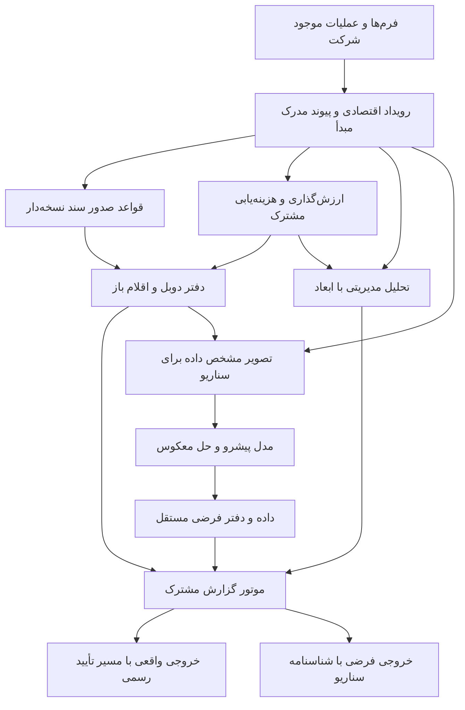

# تطبیق معماری مالی هم‌نفس با کد موجود و نقشه اجرای پیشنهادی

تاریخ: ۲۰۲۶/۱۱/۱۵، منطقه زمانی تهران. وضعیت: طراحی برای بررسی مالک؛ اجرای نرم‌افزار، مهاجرت داده و انتشار مجاز نشده است.

نتیجه بررسی مالک در همان روز: نقشه به‌عنوان مبنا پذیرفته شد. ادامه مجاز، ارائه [قرارداد مرحله اول با مثال خرید تا تسویه](FINANCIAL-PHASE-1-PURCHASE-EXAMPLE.fa.md) پیش از اجراست؛ فرض‌های ارزش موقت و جزئیات حساب‌ها/قواعد آن هنوز پیشنهاد قابل بررسی‌اند.

## ۱. مبنا و دامنه بررسی

سند مالک با عنوان «Nafasyar Financial Intelligence Core — Architecture Charter v1.0» مبنای مصوب معماری است. نسخه بدون تغییر در [سند مبنا](FINANCIAL-ARCHITECTURE-CHARTER-v1.0.fa.md) نگهداری می‌شود؛ SHA-256 آن `533d7333c66b7b1c0811a0db2100d5e4d901a8404c515b03126cf679531175dc` است. جزئیات این نقشه، پیشنهاد اجرایی‌اند و تصویب معماری به معنای تصویب خودکار همه انتخاب‌های فنی زیر نیست.

مبنای کد: مخزن `alimahmoodyar/nafasyartebcrm`، شاخه انتشار `sites/nafasyar-trace`، کامیت `58eaf4e5fd760bb18e1e1428ed32d2d7564e99ea`، درخت `3ee96c0e9a62831098e3684f4c4a1a293a9aabcf`. HEAD محلی detached است؛ سر شاخه گیت‌هاب با `git ls-remote` برابر همین کامیت تأیید شد. شاخه `main` برنامه جداگانه است و در این بررسی به‌عنوان کد برنامه آنلاین فرض نشده است.

تمام ۱۲۶۷ مسیر ثبت‌شده در Git فهرست شدند: ۱۸۷ فایل app، ۳۴۴ فایل lib، ۲۴۸ فایل components، ۳ فایل db، ۵۰ فایل drizzle، ۱۶ فایل desktop، ۲۷۸ فایل tests و سایر مستندات، تنظیمات، دارایی‌ها و همراه‌ها. جست‌وجوی ساختاری روی ۸۳۱ فایل متنی پیاده‌سازی در برنامه، API، ماژول‌ها، رابط‌ها، پایگاه داده، مهاجرت‌ها، اسکریپت‌ها، واسط دسکتاپ و دو برنامه همراه انجام شد. ورودی‌های مالی اصلی و مسیرهای مرتبط به‌صورت هدفمند خوانده شدند. این پوشش، فهرست‌برداری کل منبع و تحلیل معماری دامنه‌هاست؛ ادعای بازبینی دستی تک‌تک خطوط یا ممیزی امنیتی کامل نیست.

شواهد مسیرها، نوع فایل و شناسه محتوایی Git در [فهرست منبع](FINANCIAL-SOURCE-INVENTORY-2026-11-15.json) ثبت است. اسرار، تنظیمات محیط عملیاتی، داده شرکت، کد داخلی وابستگی‌های نصب‌شده و خروجی‌های نادیده‌گرفته‌شده ساخت وارد سند نشده‌اند. این نوبت آزمون اجرایی یا مرورگر انجام نشده است؛ «آزمون موجود» یعنی فایل آزمون در مخزن وجود دارد، نه اینکه اکنون پاس‌شدنش ادعا شود. وضعیت انتشار این طراحی «منتشرنشده» است.

## ۲. نتیجه اصلی

هم‌نفس زیرساخت عملیاتی قابل استفاده دارد؛ نباید ERP از ابتدا بازنویسی شود. خرید، موجودی، تولید، فروش، خدمات، خزانه، اموال و پرسنلی منابع اطلاعات‌اند. اما دفتر حسابداری دوبل مشترک، مدل رسمی ابعاد، موتور عمومی قواعد صدور سند، گزارش‌ساز نسخه‌دار و محیط شبیه‌سازی مالی هنوز در کد بررسی‌شده پیاده‌سازی متناظر با سند مبنا ندارند.

سه وضعیت در جدول‌ها استفاده شده است: **داریم** یعنی قابلیت محدودِ توصیف‌شده در کد قابل شناسایی است؛ **تکمیل** یعنی هسته‌ای موجود است ولی تمام الزام سند پوشش ندارد؛ **جدید** یعنی پیاده‌سازی متناظر پیدا نشده و باید طراحی و ساخته شود. وجود فرم یا نام قابلیت، اثبات کامل‌بودن آن نیست.

## ۳. ماتریس پوشش عملیات و منابع اقتصادی

| حوزه | وضعیت | آنچه در کد داریم و مرجع | تکمیل موردنیاز |
|---|---|---|---|
| داده مشترک و ذخیره‌سازی | داریم / تکمیل | `db/schema.ts`، `lib/storage.ts`؛ records، flow_entities، گردش انبار، D1 و فایل‌های R2 | قرارداد مشترک رویداد اقتصادی؛ حفظ منبع مشترک همه نقش‌های عملیاتی |
| درخواست خرید کارکنان و تأمین انبار | داریم / تکمیل | `lib/employee-purchases.ts`، `lib/employee-fulfillment.ts`، `lib/sourcing.ts`؛ APIها و پنل‌های هم‌نام | تعیین اینکه هر تغییر چه زمانی فقط تعهد است و چه زمانی اثر حسابداری دارد؛ بدون سند برای صرف درخواست |
| استعلام، کنترل مالی و سفارش | داریم / تکمیل | `lib/procurement-commercial.ts`، `lib/sourcing-quote-comparison.ts`، `lib/sourcing-workflow.ts`؛ آزمون `procurement-approved.cjs` | اتصال رویدادها و شروط مصوب به هسته؛ حفظ مذاکره، مجوزهای استثنا و شرایط پرداخت |
| خرید خدمات و ساخت پیمانکاری | داریم / تکمیل | `lib/purchase-services.ts`، `lib/subcontract.ts`، `lib/subcontract-balance.ts`، `lib/subcontract-receipts.ts` | سند مواد امانی، اجرت کسب‌شده، ضایعات و کسری با مبنای مصوب؛ جلوگیری از شمارش هم‌زمان خدمت و فاکتور |
| خرید خارجی و تسویه | داریم / تکمیل | `lib/foreign-purchase.ts`، `lib/purchase-settlement.ts:25`؛ مبلغ ارزی، نرخ تبدیل و تخصیص هزینه خرید | ارز عملیاتی با حسابداری چندارزی کامل متفاوت است؛ نرخ‌های نسخه‌دار، تفاوت تسعیر و ارز پایه لازم است |
| دریافت، کیفیت و جانمایی | داریم / تکمیل | `lib/material-flow.ts`، `lib/incoming-qc.ts`، `lib/stock-quality.ts`، `lib/receipt-purchases.ts` | تعیین ارزش موقت، مالکیت اقتصادی و قطع دوره؛ «در قرنطینه» با «فاقد ارزش مالی» یکسان فرض نشود |
| موجودی، انتقال و شمارش | داریم / تکمیل | `db/schema.ts:77` تا inventory_entries؛ `lib/inventory-counts.ts`، `lib/warehouse-history.ts` | دفتر ارزش با زنجیره اصلاح ارزش و اسناد کسری/اضافه؛ انتقال داخلی نباید هزینه تکراری بسازد |
| تولید نیمه‌آماده و نهایی | داریم / تکمیل | BOM نسخه‌دار، production_orders/materials/receipts؛ `lib/routine-production.ts`، `lib/routine-planning.ts`، `lib/finished-planning.ts` | پوشش یکسان ارزش WIP، نیمه‌آماده، نهایی، ضایعات و دوباره‌کاری در همه مسیرها |
| تولید سفارشی و پروژه | داریم / تکمیل | `lib/build-intake.ts`، `lib/build-projects.ts:24`، مسیر project-execution؛ زمان/مواد/خدمت/گزارش پروژه | مصوبه BOM پایه + تغییرات سفارش هنوز باید با مالک جزئیاتش روشن شود؛ اتصال بهای سفارش به دفتر و درآمد مستقل از بستن پروژه |
| فروش و وصول | داریم / تکمیل | `lib/sales.ts`، `lib/sales-bank.ts`، `lib/sales-monitor.ts`، `lib/sales-return-workflow.ts` | رویداد درآمد، دریافت، تخصیص، برگشت و بهای کالای فروش‌رفته جدا؛ سود واقعی مشتری هنوز از تخفیف/قیمت‌گذاری استنتاج نشود |
| خدمات خانگی و بیمارستانی | داریم / تکمیل | `lib/service-commercial.ts`، `lib/service-payments.ts`، `lib/service-office.ts`، `lib/hospital.ts`؛ service_ledger/offsets | اتصال هزینه و درآمد پرونده، گارانتی و داغی به هسته؛ service_ledger دفتر کمکی خدمات است و دفتر کل دوبل نیست |
| خزانه و تطبیق بانک | داریم / تکمیل | `lib/treasury.ts:76,86`، `lib/purchase-treasury.ts:7,49`؛ گردش، تعهد خرید، پرداخت جزئی و تطبیق | پوشش یکپارچه همه منابع وجه؛ سند حسابداری از اجرای واقعی، نه مجوز؛ وضعیت بانک و دفتر جدا |
| چک، تنخواه و ضمانت | داریم / تکمیل | `lib/treasury.ts:182`، `lib/guarantees.ts`، `lib/hospital-expenses.ts` | انواع برگشت/ابطال/تعویض، تضمینی/تجاری، نگهداری و ارتباط دفتر؛ جزئیات باز قبلی در FINANCE-DESIGN-RESUME محفوظ است |
| بدهی و فاکتور خرید | داریم / تکمیل | `lib/purchase-payables.ts:26,37`، `app/api/purchase-payables/route.ts`، `lib/purchase-invoice.ts` | حساب کنترل پرداختنی، دریافت بدون فاکتور، اقلام باز و تطبیق با دفتر مشترک |
| فاکتور رسمی و مؤدیان | داریم / تکمیل | `lib/purchase-invoice-contract.ts:1`، `lib/purchase-invoice.ts`؛ وضعیت و مدارک پیگیری | داشتن وضعیت به معنی اتصال مستقیم و پذیرش سرویس بیرونی نیست؛ قالب/اتصال معتبر و شواهد ارسال باید جدا ساخته/تأیید شود |
| هزینه‌ها و تخصیص ابتدایی | داریم / تکمیل | `lib/expense-register.ts:1`؛ طبقه، مقصد و پیشنهاد مبتنی بر شرح؛ هزینه خدمات خریداری‌شده | شرح و مرکز متنی به ابعاد معتبر متصل شود؛ پیشنهاد طبقه‌بندی با ثبت خودکار سند یکی نیست |
| اموال و نگهداری | داریم / تکمیل | `lib/assets.ts`، `lib/asset-workflow.ts:86`؛ تحویل، امانت، سرویس، توقف و خروج؛ financeFollowup | بهای تحصیل، ارزش دفتری، استهلاک، مخارج بعدی، سود/زیان خروج و اتصال خرید به مال باید اضافه شود |
| پرسنلی و حقوق | داریم / تکمیل | `lib/personnel.ts:169`؛ حکم، کارکرد، محاسبه، فیش، مساعده/وام، تأیید و پرداخت | اتصال حقوق قطعی و پرداخت به هسته/خزانه، تسهیم دستمزد به فعالیت، فایل‌های تخصصی دوره؛ دستگاه تردد هنوز متصل نیست |
| حمل و برنامه‌های همراه | داریم / تکمیل | `lib/transport.ts`، `lib/domestic-freight.ts`، public-cargo و survey-site | هزینه حمل یک‌بار با تخصیص به خرید/فروش/پروژه؛ صفحه عمومی مرجع مالی یا مجوز دیدن اطلاعات مالی نیست |

## ۴. ماتریس هسته مالی، تحلیل، گزارش و شبیه‌سازی

| الزام سند | وضعیت | شواهد و مرز قابلیت موجود | کار لازم |
|---|---|---|---|
| شناسه، مدرک و عامل عملیات | تکمیل | inventory_operations، access_audit، revision/history دامنه‌ها و فایل‌های مبدأ | رویداد اقتصادی تغییرناپذیر و سطری، نسخه مبدأ و پیوند اصلاح؛ تمام تاریخچه‌ها اکنون قرارداد واحد ندارند |
| اشخاص و شخصیت حقوقی | تکمیل / جدید | شناسنامه‌های supplier، sales_agent، as_agent و اعضا؛ `representative-identity.ts` | مرجع طرف اقتصادی با نگاشت به شناسنامه‌های موجود؛ عدم ادغام خودکار اشخاص مشابه؛ دامنه شخصیت حقوقی صریح |
| ابعاد مدیریتی | تکمیل / جدید | شناسه محصول، سریال/بچ، انبار، پروژه، فرد و قرارداد در دامنه‌های مربوط وجود دارد | تعریف ابعاد، نوع، دامنه، تاریخ اعتبار و الزام؛ مرکز هزینه/سود مشترک و شاخص‌گذاری لازم |
| کدینگ و سه جایگاه تفصیل | جدید | schema و مسیرهای اجرایی بررسی شدند؛ مدل دفتر کل و کدینگ مشترک پیدا نشد | گروه/کل/معین، تفصیل‌های شناور، قواعد سازگاری و منع حذف حساب استفاده‌شده |
| ثبت دوبل و قواعد صدور | جدید | treasury و service_ledger و inventory_entries دفترهای عملیاتی‌اند | رویداد، قاعده نسخه‌دار، سند/سطور، توازن، ضدتکرار، پیش‌نویس و قطعی؛ یک موتور برای همه |
| اصلاح، برگشت، افتتاح و بستن سال | جدید | تاریخچه و عملیات اصلاحی دامنه‌ای موجود است | اصلاح سند قطعی با ارجاع، افتتاح/اختتام، دوره بسته و اقلام باز؛ بدون دستکاری خام مبدأ |
| چندارزی حسابداری | تکمیل / جدید | ارز حساب خزانه و خرید خارجی، fxRate در تسویه | مبلغ اصلی/ارز، معادل ارز پایه، منبع نرخ و تاریخ آن، گردکردن و تفاوت تسعیر |
| بهای مواد و استاندارد BOM | تکمیل | `lib/costing.ts:20`؛ میانگین موزون متحرک، BOM بازگشتی، قیمت نامعلوم، اختلاف مواد؛ `tests/costing.cjs` | حفظ محاسبه مشترک؛ تطبیق با همه وضعیت‌های مالکیت، مسیرهای تولید و سیاست ارزش‌گذاری مصوب |
| دستمزد و سربار زمانی | تکمیل | `lib/costing.ts:62`؛ نرخ‌ها و زمان cost_time، ظرفیت عادی و سربار جذب‌نشده | اتصال به فعالیت/فرد/منبع حقوق و جلوگیری از هزینه مضاعف؛ مدل فعلی ABC/TDABC کامل نیست |
| ABC و TDABC | جدید روی زیرساخت موجود | زمان، فعالیت تولید و تخصیص ابتدایی مبنا هستند | مخزن هزینه منابع، محرک، ظرفیت عملی، نرخ ظرفیت، معادله زمان و نسخه تخصیص؛ تفکیک هزینه بلااستفاده |
| بهای پروژه/سفارش | تکمیل | `lib/build-projects.ts:24`؛ مواد، زمان مصوب، هزینه تخصیصی و خدمات | مدل هزینه مشترک برای سفارش و مراحل؛ تطبیق با دفتر و جلوگیری از تخصیص دوگانه |
| نقدینگی و اقلام باز | تکمیل | treasuryView پیش‌بینی ۷/۱۵/۳۰ روزه و مانده هر ارز، AP و حساب نمایندگان | پیش‌بینی وصول/پرداخت همه منابع، عدم جمع ارزهای نامتجانس، تفاوت پیش‌بینی با صورت جریان وجوه نقد |
| سودآوری چندبعدی | تکمیل / جدید | pricing و گزارش پروژه، برخی گزارش‌های فروش و خدمات | درآمد/بهای تحقق‌یافته، برگشت، تخفیف، هزینه مشترک و مرز کامل‌بودن به تفکیک ابعاد |
| موتور مشترک گزارش | جدید با استفاده از خروجی‌های فعلی | financeReports در `lib/finance-control.ts:3` فهرست مدارک و کنترل است؛ `/api/finance` فایل/یادداشت می‌خواند | قالب/نسخه، نگاشت، اجرای ثابت، سطر محاسبه و تبار عدد؛ گزارش‌های دامنه‌ای به‌تدریج متصل شوند |
| دفاتر و صورت‌های مالی | جدید | نام گزارش یا بارگذاری فایل حسابداری خارجی، تولید دفتر از رویدادها نیست | تراز، روزنامه/کل/معین/تفصیل، صورت‌های مالی و جریان وجه نقد از همان دفتر و قواعد معتبر |
| گزارشگری قانونی و مالیاتی | تکمیل / جدید | پیگیری مدارک فاکتور خرید و حسابداری خارجی وجود دارد | نسخه قالب، نگاشت، تعدیلات مستند و کنترل ارسال رسمی؛ الزامات زمان اجرا جدا راستی‌آزمایی شوند |
| گزارش قابل بازتولید | تکمیل / جدید | fingerprint و cost_close در `/api/costing` با stale detection | مبنای سراسری داده/قاعده/قالب/نسخه نرم‌افزار؛ تغییر گذشته، گزارش تثبیت‌شده را بازنویسی نکند |
| محیط سناریو و عکس داده | جدید | training_* و role preview آزمایش نقش هستند، نه شبیه‌سازی مالی | snapshot پایدار، تغییرات سناریو، دسترسی و نگهداری مستقل؛ عملیات شرکت همچنان مشترک بماند |
| مدل پیشرو و حل معکوس | جدید | موتور Scenario/Constraint/Solver در منبع اجرایی پیدا نشد | مدل روابط، متغیر/هدف/محدودیت، حل چندسناریویی و توضیح اختلاف؛ عدم تولید رویداد واقعی |
| نقش‌ها و API/MCP | داریم / تکمیل | permissions، financial-access، مالی حوزه‌ای و `lib/mcp/tools.ts:257,671,786` | نقش/اختیار تنظیم قواعد، قطعی‌کردن، حسابرسی، اجرای سناریو و خروجی رسمی؛ منطق مشترک و دامنه رکورد |
| پشتیبان، reset و کنترل تغییر | داریم / تکمیل | `lib/reset-contract.ts`، `lib/system-reset.ts` و قفل‌های مهاجرت | پوشش تمام جداول/فایل‌های مالی و سناریو، ترتیب بازیابی، دوره بسته و مرز نگهداری حسابرسی |
| مقیاس و پردازش گزارش | تکمیل / جدید | بعضی مسیرها همه تاریخچه را با `.all()` می‌خوانند؛ نمونه `/api/costing:12` | خواندن محدود، شاخص، محاسبه افزایشی، کار پس‌زمینه و snapshot؛ ظرفیت هنوز اندازه‌گیری نشده است |

## ۵. اختلاف‌های معماری که نباید پنهان بمانند

۱. `service_ledger` و `inventory_entries` با وجود واژه ledger/entry، دفتر کل مشترک دوبل نیستند. از آن‌ها به‌عنوان مبدأ و دفتر کمکی استفاده می‌کنیم؛ جمعشان را سند دوبل اعلام نمی‌کنیم.

۲. `cost_close` گزارش مدیریتی ثابت می‌سازد؛ دوره حسابداری را نمی‌بندد. «بستن پروژه» نیز به‌تنهایی درآمد یا سند حسابداری ایجاد نمی‌کند (`build-projects-panel.tsx:67`). این وضعیت‌ها باید جدا بمانند.

۳. پرداخت خرید از خزانه مرکزی انجام می‌شود، اما `lib/personnel.ts:181` پرداخت حقوق/مساعده را در مسیر پرسنلی ثبت می‌کند و کاتالوگ MCP همین جدایی را توضیح می‌دهد. در مرحله اتصال مالی باید یک مرجع واقعی وجه تعریف شود؛ داده تاریخی دوباره پرداخت یا کپی بی‌ارتباط نشود. این یافته، تحلیل طراحی است و هنوز با سناریوی اجرایی به‌عنوان خطای پولی اثبات نشده است.

۴. bridge دسکتاپ طبق `desktop/finance-bridge/bridge.py:1,64` فقط پنجره‌های نرم‌افزار را می‌خواند؛ نه خروجی کامل حسابداری است، نه API صدور سند و نه اتصال کامل سپیدار. جایگزین هسته پیشنهادی محسوب نمی‌شود.

۵. تمام رخدادهای اقتصادی نقدی نیستند. دریافت کالا، مصرف مواد، حقوق تحقق‌یافته، استهلاک و شناسایی درآمد می‌توانند مستقل از حرکت وجه باشند. بنابراین خزانه مرجع وجه است، نه مرجع تمام رویدادهای اقتصادی.

۶. کد برای برخی مبالغ از micro-rial و برای حقوق از ریال صحیح استفاده می‌کند؛ خزانه مبلغ را در ارز حساب نگه می‌دارد. قرارداد واحد مبلغ/ارز/دقت/گردکردن باید قبل از اتصال روشن شود؛ تغییر نام فیلد یا عدد float راه‌حل نیست.

۷. تاریخ ثبت با تاریخ وقوع و تاریخ اثر حسابداری یکی نیست. زمان انتظار مراحل تعمیر یا تولید هم به‌تنهایی زمان مفید کار نیست. گذشته با ساعت/نرخ/مدرک ساختگی تکمیل نشود.

۸. مرجع عملیاتی مشترک مصوبه قبلی محفوظ است. جداسازی در سند جدید فقط برای سناریوهای مالی فرضی است؛ ساخت انبار، نماینده یا پرونده موازی برای اجرای عملیات مجاز نیست.

۹. «پنج لایه» مرز مسئولیت است؛ برای شروع نیاز به پنج ریزخدمت و چند پایگاه داده عملیاتی نداریم. زیرساخت فعلی TypeScript/Workers/D1 حفظ می‌شود، مگر بررسی ظرفیت خلافش را ثابت کند.

## ۶. نقشه ارتباط ماژول‌ها

این نمودار وابستگی داده را نشان می‌دهد؛ تحلیل مدیریتی مجبور نیست منتظر قطعی‌شدن تمام اسناد بماند، ولی وضعیت موقت/قطعی و کامل‌بودن داده را باید نمایش دهد. تنها محاسباتی که طبق قاعده رویداد ارزش‌گذاری ایجاد می‌کنند به دفتر ارسال می‌شوند؛ نمایش گزارش خودش رویداد مالی نمی‌سازد.

## ۷. مدل داده و مرز ماژول‌های پیشنهادی

نام‌های زیر مفهومی و برای بررسی‌اند؛ هیچ جدول یا مسیر اجرایی اکنون ساخته نشده است.

| جزء | استفاده مجدد | افزوده پیشنهادی و قرارداد |
|---|---|---|
| Economic Event | شناسه رکورد/عملیات، revision، مدارک و audit موجود | Event و EventLine با شناسه یکتا، نوع/مرحله، نسخه مبدأ، تاریخ وقوع/ثبت/اثر، شخص حقوقی، مبلغ/ارز/واحد، actor/recorder و پیوند اصلاح |
| انتشار قابل بازیابی رویداد | تراکنش‌های D1 و guard دامنه‌ها | outbox در همان تراکنش مبدأ؛ مصرف حداقل یک‌بار با کلید یکتای اثر و retry؛ HTTP یا MCP اثر متفاوت نسازد |
| طرف اقتصادی | supplier، نمایندگان، member و هویت‌های موجود | Party/SourceAlias؛ نگاشت بررسی‌شده، نه حذف شناسنامه‌های عملیاتی یا ادغام بر اساس تشابه نام |
| ابعاد | product/batch/serial/warehouse/project/order/member/contract موجود | DimensionDefinition/Value و پیوند سطری معتبر؛ شاخص‌های قابل جست‌وجو؛ سه تفصیل دفتر از ابعاد مدیریتی مستقل ولی مرتبط |
| هسته دفتر | دسترسی و audit فعلی | Account، DetailType/Value، FiscalPeriod، PostingRuleVersion، Journal/Line و CorrectionLink؛ خط دفتر روی معین، تفصیل‌های مجاز طبق تنظیم |
| قواعد و تبار محاسبه | الگوهای history/fingerprint | RuleVersion و CalculationRun با ورودی، نسخه قاعده، خروجی، وضعیت و منبع عدد؛ ثبت نسخه مورد استفاده هر اجرا |
| ارزش‌گذاری و هزینه | costing، settlement، projectReport و BOM موجود | valuation/CostRun، ResourcePool، Driver، Allocation و CapacityRate؛ منطق مشترک زیر گزارش، نه فرمول مستقل در هر خروجی |
| گزارش | خروجی و UI دامنه‌ای موجود | TemplateVersion، MappingVersion، ReportExecution، Lineage و Validation؛ اجرا روی dataset مشخص |
| سناریو | هویت و مجوز کاربر | Scenario، SnapshotManifest، Change، Target، Variable، Constraint و Run؛ دفتر فرضی فقط در مخزن سناریو |

Event جایگزین رکورد عملیاتی یا کپی آزاد فاکتور نیست؛ واقعیت اقتصادی یک مرحله و نسخه مبدأ را تثبیت می‌کند. کلید ضدتکرار باید نوع/نسخه رویداد و دامنه اثر را بشناسد تا هم retry بی‌اثر باشد و هم اصلاح واقعی مستقل ثبت شود. ادعای انتقال تضمینی بدون outbox و کنترل اتمی قابل قبول نیست.

پیشنهاد پوشه‌بندی: `lib/economics/` برای قرارداد و تطبیق مبدأ، `lib/accounting/` برای دفتر و قواعد، `lib/financial-reporting/` برای اجرا و تبار، `lib/simulation/` برای مدل فرضی. هزینه‌یابی موجود با واسط مشترک گسترش یابد؛ حساب‌ها یا محاسبات موازی برای هر زیرسیستم ساخته نشود.

APIهای پیشنهادی: `/api/accounting/accounts`، `periods`، `rules`، `journals`، `exceptions`؛ `/api/financial-reports/templates`، `runs` و `lineage`؛ `/api/simulation/scenarios`، `runs` و `comparison`. فرم‌های عملیاتی فعلی مبدأ می‌مانند. رویداد داخلی endpoint عمومیِ ثبت آزاد واقعیت نمی‌گیرد. هر قابلیت جدید در MCP همان handler دامنه و کنترل را استفاده می‌کند.

## ۸. موتور قواعد و گزارش مشترک

قاعده مصوب مدیر مالی شامل نوع و مرحله رویداد، شروط محدود، تاریخ اعتبار، منابع مبلغ/حساب/تفصیل/ابعاد، روش پیش‌نویس یا خودکار و مالک استثناست. برای رویداد پشتیبانی‌شده الگوی آماده داریم؛ اسکریپت آزاد، eval و تصمیم مالی قطعی مدل زبانی پیشنهاد نمی‌شود. نبود قاعده، تداخل قواعد، مبلغ نامعلوم یا دوره بسته به صف استثنا می‌رود؛ تأیید دستی بدون مدرک یا عدد صفر جایگزین نمی‌شود.

پیش از فعال‌شدن نسخه قاعده، پیش‌نمایش روی نمونه و کنترل توازن، واحد/ارز، تفصیل، تاریخ و دامنه لازم است. تغییر قاعده اسناد پیشین را خودکار عوض نمی‌کند. قواعد تطبیق بانک و مجوزهای موجود حفظ می‌شوند؛ نام «خودکار» مجوز حذف کنترل فیزیکی یا تخصصی نیست.

موتور گزارش از قرارداد واحد `FinancialDatasetReader` می‌خواند. پیاده‌سازی واقعی و سناریویی متفاوت‌اند ولی نسخه قالب، نگاشت، فرمول و کنترل یکسان‌اند. قیمت/استهلاک/تخصیص در موتور محاسبه مشترک نسخه‌دار تولید می‌شود؛ گزارش آن را دوباره با الگوریتم متفاوت حساب نمی‌کند.

هر اجرای گزارش، شناسه مبنای داده یا watermark معتبر، نسخه قواعد/قالب/نگاشت/نرم‌افزار، ارز و واحد نمایش، فیلترها و زمان اجرا دارد. نسخه تثبیت‌شده باید با ورودی‌های ثابت بازتولید شود. برای هر سطر، مسیر جمع تا سند و رویداد و مدرک قابل مشاهده است؛ ارقام سناریو علاوه بر آن به فرضیات متصل‌اند. برچسب واقعی/فرضی در نمایش و تمام خروجی‌ها باقی می‌ماند. مسیر ارائه رسمی فقط dataset واقعیِ مجاز و کنترل‌شده می‌پذیرد.

## ۹. محیط سناریو و حل معکوس پیشنهادی

پیشنهاد اولیه جداسازی، binding پایگاه داده مستقل برای داده سناریو و فضای فایل محدود به همان محیط است؛ انتخاب نهایی به حجم و هزینه snapshot وابسته است. فعلاً این گزینه تصویب یا ایجاد نشده است. جدول‌های training_* برای سناریوی مالی بازاستفاده نشوند: قرارداد فعلی‌شان آموزش/آزمون نقش است و جداسازی حقوق و نگهداری موردنیاز مالی را به‌خودی‌خود ثابت نمی‌کند.

۱. تصویر یک مبنای سازگار و ثابت از منابع موردنیاز ایجاد شود؛ snapshot با خواندن متوالیِ داده در حال تغییر، بدون نسخه/کنترل، معتبر نیست. منشأ، ساعت مبنا، قواعد و هش محتوا ثبت شوند.

۲. تغییرات در overlay سناریو قرار بگیرند و داده واقعی فقط‌خواندنی باشد. مجوز سناریو خودبه‌خود مجوز دیدن حقوق افراد یا اطلاعات حساس مبدأ نمی‌دهد. اشتراک، انقضا، حذف و بازیابی snapshot نیز بررسی شوند.

۳. مدل پیشرو ابتدا فروش/تولید/مصرف/بها/وصول/پرداخت و سررسیدها را محاسبه کند؛ همان قواعد حسابداری روی رویدادهای فرضی، دفتر فرضی بسازند. هیچ پیامک، پرداخت، ارسال رسمی یا جابه‌جایی موجودی از سناریو صادر نشود.

۴. حل معکوس نسخه اول با متغیرهای محدود، کران‌دار و سناریوهای قابل توضیح آغاز شود؛ برای روابط خطی می‌توان حل خطی و برای تعداد صحیح تولید حل عددصحیح را بعداً انتخاب کرد. حل سنگین و طولانی داخل درخواست تعاملی Workers اجرا نشود؛ انتخاب حل‌کننده و محل کار پس‌زمینه پس از آزمون حجم انجام شود.

۵. محدودیت‌ها شامل مواد، ظرفیت، اندازه بچ/بسته، تقاضا، قیمت، نقدینگی، سررسید، ارز و قواعد مصوب باشند. توازن دفتر به‌تنهایی کفایت اقتصادی را ثابت نمی‌کند. خروجی بین «شدنی»، «با فرض‌های ناقص»، «غیرشدنی» و «حل متوقف‌شده» تمایز بگذارد؛ پایان زمان حل اثبات ناممکن‌بودن نیست.

۶. چند جواب با معیار روشن، مثلاً کمترین تغییر نسبت به مبنا یا کمترین نیاز نقد، رتبه‌بندی شوند. معیار ریسک تا وقتی ورودی و قاعده‌اش تعریف نشده ساخته نشود. هر پیشنهاد تفاوت مقدار، قیمت، هزینه، زمان و وصول را توضیح دهد.

## ۱۰. ماتریس نقش پیشنهادی

این‌ها اختیار هستند و الزاماً شغل یا پروفایل تازه برای هر سطر ساخته نمی‌شود. تخصیص به نقش‌های موجود پس از بررسی دسترسی انجام می‌شود.

| نقش/اختیار | اقدام مجاز | مرز |
|---|---|---|
| کاربر عملیاتی | همان فرم فعلی، دیدن نتیجه مرتبط و اصلاح از مسیر دامنه | بدون تنظیم کدینگ یا دسترسی مالی عمومی |
| خزانه‌دار | اجرای دریافت/پرداخت مجاز و مدارک وجه | مجوز اجرا و تطبیق مستقل طبق قواعد موجود؛ سند دفتر را خام ویرایش نکند |
| حسابدار حوزه‌ای | بررسی استثنا و تطبیق اسناد همان حوزه | داده حقوق یا حوزه دیگر صرفاً با مجوز صریح |
| مسئول حسابداری | بررسی سند و پایان دوره در حدود اختیار | استقلال تأیید و منع خودتأییدی لازم |
| مدیر مالی | قواعد/کدینگ/نگاشت، نسخه نرخ و دوره، تأیید گزارش | تست پیش از فعال‌سازی و تاریخچه غیرقابل حذف |
| تحلیلگر مدیریتی | گزارش و تحلیل مجاز، درخواست/اجرای سناریو در صورت اعطا | بدون قطعی‌کردن سند یا تغییر واقعیت |
| حسابرس/بازبین | خواندن مدرک، تبار و نسخه‌های مجاز و خروجی | بدون ثبت عملیات یا تغییر قواعد |
| مدیرعامل | شاخص‌ها، تصمیم استثنا و اختیارات مصوب | دیدن یا تغییر جزئیات حساس و دفتر نیاز به دامنه مجوز دارد |
| سرویس داخلی | انتقال رویداد، محاسبه و retry تحت قاعده مشخص | هویت سیستمی، عامل مبدأ و دلیل محفوظ؛ نقش انسان جعل نشود |

## ۱۱. نقشه اجرا و شرط خروج هر مرحله

| مرحله | خروجی قابل بررسی | معیار پذیرش پیش از ادامه |
|---|---|---|
| ۰. تصویب نقشه | تعیین حداقل دامنه، ابهام‌ها و سیاست‌های مبدأ/ارزش | تصمیم‌های بند ۱۴ مشخص؛ اجرای مالی جامع هنوز شروع نشده |
| ۱. قرارداد اقتصادی مشترک | فهرست رویدادها، مبلغ/ارز/تاریخ/ابعاد، outbox و صف استثنا برای یک مسیر | ثبت مبدأ و رویداد اتمی؛ قطع/تکرار/هم‌زمانی اثر مضاعف نسازد |
| ۲. هسته حداقلی دفتر + خرید تا تسویه | کدینگ/سه تفصیل، دوره، قواعد، سند، تراز و اصلاح؛ یک خرید با پیش‌پرداخت/دریافت/فاکتور/تسویه | هر عدد تا مبدأ، توازن کامل، اقلام باز و خزانه با دفتر تطبیق کنند؛ حسابدار سناریو را بپذیرد |
| ۳. حالت‌های ضروری و سایر پول‌ها | دریافت بی‌فاکتور و مرحله‌ای، مغایرت، چک/تنخواه؛ اتصال فروش/خدمات و حقوق به مرجع وجه | خطا/اصلاح در مبدأ و سند کنترل شود؛ پرداخت/وصول تاریخی دوباره ثبت نشود |
| ۴. ارزش انبار و هزینه تولید | تکمیل valuation، WIP/نیمه‌آماده/نهایی/پروژه، حقوق تخصیصی، اموال و استهلاک | مواد، حقوق، اجرت و سربار دوبار تخصیص نیابند؛ مجهول صفر نشود؛ گردش فیزیکی و ارزش تطبیق کنند |
| ۵. گزارش یکپارچه و پایان دوره | ارتقای تراز ساده مرحله ۲ به قالب‌های نسخه‌دار، صورت‌ها، جریان وجه و خروجی‌های دوره | کنترل جمع/نگاشت، افتتاح تا اختتام و افتتاح بعد، بازتولید با مبنای ثابت و بررسی مالی |
| ۶. ABC/TDABC و سودآوری | مخزن منابع، محرک، ظرفیت عملی، زمان و تحلیل انحراف | هزینه تخصیص‌یافته + جذب‌نشده با مخزن منابع برابر؛ زمان انتظار به‌جای زمان کار ننشیند |
| ۷. سناریوی پیشرو | snapshot ایزوله، تغییر فرض، دفتر فرضی و همان گزارش‌ساز | ورودی برابر خروجی برابر؛ هیچ تغییر یا اثر خارجی در محیط واقعی نداشته باشد |
| ۸. حل معکوس محدود و توسعه تدریجی | هدف، کران، چند جواب، رتبه و توضیح اختلاف | مثال شدنی/ناممکن/کم‌داده/پایان زمان از هم تشخیص داده شوند؛ اثرات موجودی و نقد و زمان کنترل شوند |

مرحله ۲ از ابتدا گزارش تراز و گردش ساده برای راستی‌آزمایی دارد؛ ساخت گزارش به انتهای پروژه موکول نمی‌شود. هر مرحله یک زنجیره کامل با فرم‌های فعلی است، نه فهرست بلندی از آیکون‌ها. سناریوی پایلوت تولید سفارشی می‌تواند پس از نهایی‌شدن گردشش، نمونه مرحله ۴ باشد.

## ۱۲. مهاجرت و گذار پیشنهادی

- ابتدا نگاشت شناسنامه‌ها، واحدها، ارزها، تاریخ‌ها و کیفیت داده تهیه شود. نام یکسان دلیل یکی‌بودن طرف حساب یا کالا نیست.
- تغییر schema فقط با طرح مهاجرت افزایشی و بررسی اثر انجام شود؛ موجودیت‌های مالی پایدار و پرارجاع با قیود و شاخص مناسب طراحی شوند، نه صرفاً JSON بدون کنترل.
- اطلاعات تاریخی قابل بازسازی، با شناسه و منشأ قدیمی و نسخه قاعده مشخص منتقل شوند. برای بخش نامطمئن، مانده و اقلام باز تأییدشده با تاریخ مبنا وارد شوند؛ رویداد یا نرخ فرضی به گذشته نسبت داده نشود.
- تاریخ شروع دفتر جدید و مرجع رسمی دفتر در دوره گذار تعیین شود. اجرای سایه برای مقایسه است؛ دو سیستم نباید یک پرداخت واقعی یا یک رویداد را دوبار اجرا کنند.
- اجرای آزمایشی مهاجرت روی کپی مجاز، تطبیق تعداد/مقدار/مبلغ/مانده و آزمون بازیابی الزامی است. صرف وجود فایل backup کافی نیست.
- reset-contract، freeze، ترتیب FK، فایل‌های R2 و مبنای نگهداری اسناد مالی/سناریو پیش از اضافه‌شدن داده پایدار به‌روز شوند؛ این بررسی مجوز reset داده شرکت نیست.
- بعد از تصویب و اجرای هر مرحله، قبل از پوش مقایسه کامل منبع و بعد از انتشار تأیید نسخه واقعاً زنده انجام شود. فایل‌های مستنداتی این نوبت هنوز کامیت، پوش یا منتشر نشده‌اند.

## ۱۳. برنامه آزمون و شواهد موجود

فایل‌های موجود قابل استفاده: `tests/treasury.cjs`، `purchase-payables.cjs`، `purchase-settlement.cjs`، `procurement-approved.cjs`، `procurement-completion.cjs`، `costing.cjs`، `build-projects.cjs`، `sales-bank.cjs`، `service-payments.cjs`، `personnel.cjs`، `assets.cjs`، `asset-workflow.cjs`، `finance-workspace.cjs`، `finance-shortage-access.cjs`، `mcp-integration.cjs` و `system-reset.cjs`. وجود این فایل‌ها شواهد پیاده‌سازی دامنه است؛ جامعیت مالی جدید یا پاس‌شدن فعلی‌شان از این بررسی نتیجه نمی‌شود.

آزمون‌های جدید لازم برای هر مرحله:

۱. **پول و دفتر:** توازن، precision/rounding، سه تفصیل، ارز، دوره بسته، اصلاح/برگشت، خودتأییدی و مرجع مبدأ؛ retry همسان، UUID متعارض و اجرای هم‌زمان.

۲. **اتصال:** قطع بین ثبت عملیات و پردازش، رویداد دیررس/خارج‌ترتیب، اصلاح و ابطال مبدأ، بازیابی outbox، کنترل برابری اقلام باز/دفتر و عدم پرداخت مضاعف.

۳. **هزینه:** BOM چندسطحی، WIP و انتقال، ضایعات/دوباره‌کاری، اجرت پیمانکار، زمان واقعی، ظرفیت بلااستفاده، نرخ ناقص و جمع مخزن هزینه؛ دوره بسته/داده دیررس.

۴. **گزارش:** حساب بدون گردش ولی دارای مانده، نگاشت ناقص/هم‌پوشان، سطر جمع، موجودی اول/ورود/خروج/پایان، برابری دفاتر و صورت‌ها، تبار و بازتولید نسخه.

۵. **سناریو:** برابری واقعی و سناریو با تغییر صفر، عدم نوشتن به actual حتی از API/MCP، تفکیک دامنه کاربر/شخصیت حقوقی، عدم افشای حقوق، خروجی فرضی غیرقابل ارسال رسمی و عدم اثر خارجی.

۶. **حل معکوس:** هدف قابل تحقق، ناسازگار و کم‌داده، تعداد صحیح/ظرفیت/سررسید، چند جواب و معیار رتبه، اعلام صریح توقف محاسبه؛ کنترل پیشرو مجدد جواب حل‌کننده.

۷. **عملکرد و بازیابی:** با حجم و هم‌زمانی توافق‌شده، query محدود و کار پس‌زمینه، snapshot منسجم، backup/restore و تطبیق بعد از بازیابی. این گزارش عدد تضمینی ظرفیت یا زمان تحویل ارائه نمی‌کند.

## ۱۴. تصمیم‌های باز برای بررسی مالک و مسئول مالی

| تصمیم | پیشنهاد اولیه | زمان لازم برای نهایی‌شدن |
|---|---|---|
| شروع اجرا | هسته و یک خرید عادی تا تسویه؛ پس از تصویب همین نقشه | قبل مرحله ۱ |
| مرجع دفتر و تاریخ گذار | تا پذیرش مالی، دفتر جدید در حالت مقایسه؛ تاریخ انتقال صریح | قبل ورود مانده واقعی |
| شخصیت حقوقی و ارز پایه | شروع با شرکت فعلی و IRR؛ نگهداری ارز اصلی در رویدادها؛ زیرساخت دامنه از ابتدا | قبل نهایی‌شدن مدل |
| دریافت بدون فاکتور و قرنطینه | تفکیک مالکیت/ارزش از اجازه مصرف؛ مبنای ارزش موقت و اصلاح با مالی | قبل اتصال رویداد دریافت |
| سیاست بهای موجودی | روش فعلی میانگین موزون بررسی شود؛ تغییر روش یا بازسازی گذشته بدون مصوبه نباشد | قبل دفتر ارزش |
| پرداخت پرسنلی | پرسنلی محاسبه/مجوز را نگه دارد؛ مرجع اجرای وجه و تطبیق مشترک شود | قبل مرحله ۳ |
| حساب‌ها، ابعاد و مراکز | از کدینگ و خروجی موردنیاز حسابداران نمونه بگیریم؛ سه تفصیل قبلی حفظ شود | قبل مرحله ۲ |
| زمان و محرک‌های هزینه | منبع زمان مفید و ظرفیت عملی برای فعالیت‌ها مشخص شود؛ صرف زمان سپری‌شده کافی نیست | قبل مرحله ۴ و ۶ |
| اولین هدف سناریو | سود عملیاتی و نقدینگی با متغیرهای محدود فروش/تولید/وصول | قبل مرحله ۷ |
| حجم و نگهداری | تعداد شرکت/کاربر، رویداد سالانه، تاریخچه، RPO/RTO و سطح دسترسی سناریو | قبل طراحی نهایی گزارش/سناریو |

جزئیات باز چک و دریافت بدون فاکتور در [نقطه بازگشت مالی](../FINANCE-DESIGN-RESUME.md) محفوظ است. سند جدید جایگزین اصول معماری قبلی در حد تعارض است، ولی پیشنهادهای نهایی‌نشده قبلی را بی‌صدا مصوب نمی‌کند. قالب‌ها و مقررات قانونی فقط در زمان اجرای همان حوزه با منابع معتبر بررسی خواهند شد؛ این سند تأیید انطباق قانونی نرم‌افزار نیست.

## ۱۵. نقطه توقف و قدم بعدی

سند مبنا ذخیره و تطبیق معماری انجام شد. فقط مستندات و اشاره راهنمای پروژه تغییر کرده‌اند. هیچ کد اجرایی، وابستگی، schema، migration یا داده‌ای تغییر نکرد؛ کامیت/پوش/انتشار هم انجام نشده است.

پیشنهاد برای جلسه بررسی: ابتدا ترتیب مرحله‌های ۱ تا ۳ و مرجع دفتر در گذار را نهایی کنیم؛ سپس قرارداد رویداد و یک سناریوی خرید با نمونه حساب‌ها و اسناد را نشان بدهیم. جزئیات همه فرم‌ها را از صفر باز نمی‌کنیم و ساخت هم‌زمان کل هشت مرحله را شروع نمی‌کنیم.
